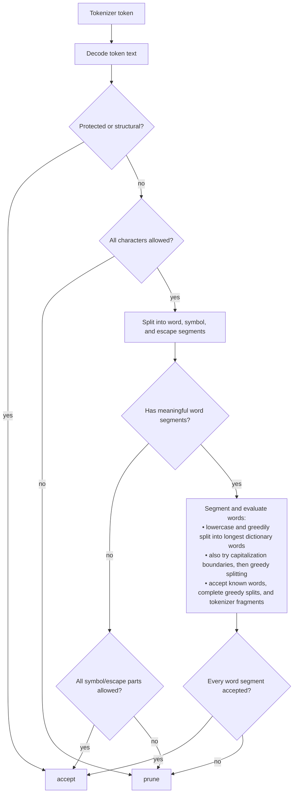

# TokenPruner

TokenPruner analyzes tokenizer vocabularies and decides which tokens to keep for a
target workload. It combines character scripts, symbol presets, dictionaries, and
`wordfreq` language evidence with a deterministic accept/prune decision tree.

## Commands

- `inspect`: load a tokenizer/model config and report vocabulary metadata.
- `analyze`: classify sampled or full vocabularies and print/save diagnostics.
- `list`: classify the full vocabulary and write reusable token ID artifacts.
- `prune`: prune a supported model with compact text-token IDs; safetensors checkpoints are rewritten shard-by-shard without loading the full model.

## Parameters

- `--model`: Hugging Face model ID or local path.
- `--trust-remote-code`: advanced Hugging Face loader flag; use only for trusted model repos that require custom Python code.
- `--keep-script`: allowed Unicode scripts for the character gate.
- `--symbol-preset`: allowed symbol families such as coding, JSON, mathematics, emoji.
- `--dictionary`: repeated custom term files for explicit domain/project vocabulary.
- `--wordfreq-lang`: broad natural-language frequency evidence.
- `--wordfreq-min-zipf`: absolute word frequency cutoff; default/recommended threshold style.
- `--wordfreq-top-pct`: relative top-percent language vocabulary cutoff; alternative to Zipf.
- `--workers`: parallel token classification for `analyze`, `list`, and `prune`.
- `--sample-size`: `analyze` token sample size; `-1` means all.
- `--seed`: deterministic `analyze` sampling/examples.
- `--show`: stdout display mode, e.g. `stats`, `all`, `examples`, `json`.
- `--save [DIR]`: filesystem artifact directory for `analyze`, `list`, and `prune`; omit `DIR` to use a generated path based on the model and policy.
- `--retained-token-ids`: `prune` reuses a previous `list` keep-list and skips reclassification.
- `--yes`: skip prune confirmation prompts.

`--show` prints to stdout. `--save` writes files. Bare `--save` uses
`tokenpruner_artifacts/<command>/<model-and-policy-slug>/`. `analyze --save` writes
`{token_decisions.jsonl, summary.md, policy.json}`. `list --save` writes
`{retained_token_ids.txt, pruned_token_ids.txt, token_decisions.jsonl, policy.json}`.
`prune --save` writes the remapped model plus token maps and `pruning_report.json`.
Use either `--wordfreq-min-zipf` or `--wordfreq-top-pct`, not both.

For safetensors checkpoints, `prune` copies non-vocabulary tensors unchanged and
slices only vocabulary-bearing tensors such as token embeddings, LM heads, MTP
heads, and matching row-wise quantization side tensors. Full model loading is a
fallback for unsupported non-safetensors checkpoints.

For indexed safetensors checkpoints, `model.safetensors.index.json` is treated as
authoritative: every referenced shard or sidecar, such as `model_mtp.safetensors`,
must be present, non-empty, and readable before pruning starts.

## Example Results

This run keeps Latin/Common/Inherited characters, all built-in symbol presets,
and English/German/Spanish word-frequency evidence at Zipf >= 3:

```bash
tokenpruner prune \
  --model inferRouter/Qwen3.6-27B-NVFP4 \
  --keep-script Latin Common Inherited \
  --symbol-preset all \
  --wordfreq-lang en de es \
  --wordfreq-min-zipf 3 \
  --workers 14 \
  --show stats
```

For the 35B A3B run, use the same command and change only `--model` to
`nvidia/Qwen3.6-35B-A3B-NVFP4`.

Both tokenizers started with 248,077 tokens and retained 111,236 tokens, pruning
136,841 vocabulary entries. The checkpoint savings differ because each model
stores vocab-facing tensors differently.

| Model | Checkpoint Before | Checkpoint After | Saved | Checkpoint Reduction | Main-Path Bandwidth Saved | MTP-Path Bandwidth Saved |
| --- | ---: | ---: | ---: | ---: | ---: | ---: |
| `inferRouter/Qwen3.6-27B-NVFP4` | 23.82 GB | 21.02 GB | 2.81 GB | 12% | 7% | 41% |
| `nvidia/Qwen3.6-35B-A3B-NVFP4` | 23.42 GB | 22.70 GB | 0.72 GB | 3% | 5% | 38% |

The 35B model is A3B/MoE, so checkpoint size reduction and active weight
bandwidth reduction are different views of the same pruning result.

## Scripts

`--keep-script` accepts these script names:

- `Latin`, `Greek`, `Cyrillic`
- `Arabic`, `Hebrew`, `Devanagari`, `Thai`
- `Han`, `Hiragana`, `Katakana`, `Hangul`
- `Common` for punctuation, symbols, numbers, separators, and controls
- `Inherited` for combining marks

Script selection controls which character families may pass the character gate. It
does not select a language dictionary. For example, `Latin` can contain English,
French, German, and many other languages.

## Symbols

`--symbol-preset` accepts these preset names:

- `coding`, `shell`, `json`, `yaml`, `xml`, `markdown`
- `mathematics` for operators and common Greek math/science letters such as `π`, `λ`, and `Ω`
- `ascii-punctuation` for ASCII punctuation characters
- `emoji` for emoji and pictographic symbols
- `all` to enable every built-in symbol preset

Symbol presets allow specific punctuation, operators, emoji, or math/science
symbols to pass the character gate without broadly accepting an entire language
script. For example, `--symbol-preset mathematics` can accept `π` while
`--keep-script Greek` would more broadly allow Greek-script text.

## Languages

The built-in dictionaries are loaded together by default:

- `english`: general English words
- `programming`: programming terms
- `linux`: Linux command names
- `api`: API and library names
- `icons`: icon-related terms

The bundled natural-language dictionary is currently English only. Additional
newline-separated word lists can be supplied by repeating `--dictionary`:

```bash
tokenpruner analyze \
  --model Qwen/Qwen3.5-Coder \
  --dictionary ./dictionaries/german.txt \
  --dictionary ./dictionaries/french.txt
```

`--wordfreq-lang` is separate from the bundled dictionaries and accepts the
following `wordfreq` language codes:

| Languages | Codes |
| --- | --- |
| Arabic, Bangla, Bosnian, Bulgarian, Catalan, Chinese | `ar`, `bn`, `bs`, `bg`, `ca`, `zh` |
| Croatian, Czech, Danish, Dutch, English, Finnish | `hr`, `cs`, `da`, `nl`, `en`, `fi` |
| French, German, Greek, Hebrew, Hindi, Hungarian | `fr`, `de`, `el`, `he`, `hi`, `hu` |
| Icelandic, Indonesian, Italian, Japanese, Korean, Latvian | `is`, `id`, `it`, `ja`, `ko`, `lv` |
| Lithuanian, Macedonian, Malay, Norwegian Bokmal, Persian, Polish | `lt`, `mk`, `ms`, `nb`, `fa`, `pl` |
| Portuguese, Romanian, Russian, Serbian, Slovak, Slovenian | `pt`, `ro`, `ru`, `sr`, `sk`, `sl` |
| Spanish, Swedish, Tagalog, Tamil, Turkish, Ukrainian | `es`, `sv`, `fil`, `ta`, `tr`, `uk` |
| Urdu, Vietnamese | `ur`, `vi` |

Bosnian, Croatian, and Serbian share related `wordfreq` data; `sh` is also accepted
for the shared Serbo-Croatian list. Chinese, Japanese, and Korean may require the
optional `wordfreq[cjk]` dependencies. See the
[`wordfreq` supported-language documentation](https://github.com/rspeer/wordfreq#sources-and-supported-languages).

## Structural and Protected Tokens

- whitespace: spaces, tabs, newlines, and carriage returns
- control and format characters
- escape sequences such as `\n`, `\t`, `\xNN`, and `\uNNNN`
- tokenizer special tokens: BOS, EOS, padding, chat, and modality tokens
- byte-fallback tokens such as `<0x00>` through `<0xFF>`

## Accept/Prune Decision Tree

TokenPruner classifies each token with a deterministic decision tree. The final decision is binary:

- `accept`: keep this token as useful/protected for the target workload.
- `prune`: candidate for removal in a later pruning phase.



Examples:

- `中文,` -> `prune` if `Han` is not allowed; the comma does not rescue it.
- `classCallCheck` -> `accept` if `class`, `call`, and `check` are known.
- `typescript` -> `accept` if it fully splits into known words: `type` + `script`.
- `theros` -> `prune`; `the` is known, but `ros` is not, so the full token is not covered.
- `he` -> `accept` as a tokenizer fragment if it appears inside a known word such as `hello`.
- `{` -> `accept` with the `json` preset.
