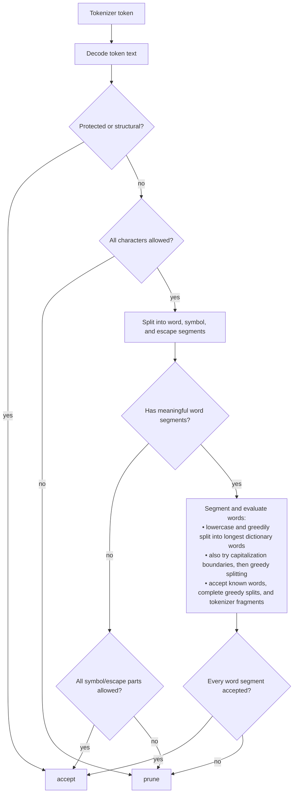

# TokenPruner

TokenPruner is a tokenizer vocabulary analysis and pruning toolkit. It can inspect a
model/tokenizer, classify sampled or full vocabularies with a deterministic
accept/prune decision tree, write retained/pruned token ID lists, and prune supported
Hugging Face language and multimodal models with compact text-token IDs.

```bash
tokenpruner inspect --model Qwen/Qwen3.5-Coder

tokenpruner analyze \
  --model Qwen/Qwen3.5-Coder \
  --keep-script Latin Common Inherited \
  --drop-script Han Hiragana Katakana Hangul Cyrillic \
  --symbol-preset coding shell json markdown \
  --wordfreq-lang en \
  --sample-size 200 \
  --show stats \
  --save ./reports/sampled_token_decisions.jsonl

tokenpruner list \
  --model Qwen/Qwen3.5-Coder \
  --keep-script Latin Common Inherited \
  --drop-script Han Hiragana Katakana Hangul Cyrillic \
  --symbol-preset coding shell json markdown \
  --wordfreq-lang en \
  --output ./lists/qwen3.5-coder-en-coding

tokenpruner prune \
  --model Qwen/Qwen3.5-Coder \
  --keep-script Latin Common Inherited \
  --drop-script Han Hiragana Katakana Hangul Cyrillic \
  --symbol-preset coding shell json markdown \
  --wordfreq-lang en \
  --show examples:20 \
  --output ./models/qwen3.5-coder-pruned-en-coding
```

`list` writes `retained_token_ids.txt`, `pruned_token_ids.txt`,
`token_decisions.jsonl`, and `policy.json`. `prune` uses compact token ID remapping
and writes `old_to_new_token_ids.json`, `new_to_old_token_ids.json`, and
`pruning_report.json` alongside the saved model/tokenizer.

Before downloading model weights, `prune` prints the original, retained, and pruned
vocabulary sizes and shows the same summary format as `analyze`. Add `--show
examples:20` to review retained and pruned examples before confirmation. Other
`analyze` display modes can also be combined through `--show`. Use `--yes` to skip
the prompt in scripts or unattended runs.

When `--retained-token-ids` is supplied, only the summary is available because that
file does not contain the token decision records needed to produce examples.

Pruning discovers every module that uses the text vocabulary. Shared input/MTP
embeddings are sliced once, while separate MTP embeddings or output heads are sliced
independently. Vision and audio encoders remain unchanged; their text-vocabulary
marker IDs are retained and remapped in the model configuration.

Quantized vocabulary modules are sliced in place, including row-aligned scale and
metadata tensors, so ModelOpt and compressed-tensors NVFP4 module classes are
preserved. Pruning requires the runtime packages needed to load the original
checkpoint, such as a compatible PyTorch build plus `nvidia-modelopt` for ModelOpt
checkpoints or `compressed-tensors` for compressed-tensors checkpoints.

Install a PyTorch build appropriate for the machine first, then install the matching
TokenPruner extra:

```bash
pip install -e '.[modelopt]'             # NVIDIA ModelOpt checkpoints
pip install -e '.[compressed-tensors]'   # Unsloth compressed-tensors checkpoints
```

When `prune` detects missing runtime packages, it prints the equivalent
`python -m pip install ...` command and asks whether to install them into the active
environment. `--yes` also approves this dependency-installation prompt.

TokenPruner refuses only unresolved differently sized vocabularies that require their
own token mapping, or modules whose vocabulary-row tensors cannot be identified.

`inspect` also reads the model configuration and reports declared modality encoders,
vocabulary-bearing submodels, embedding/LM-head tying, and MTP settings. A separate
MTP head is only reported as confirmed when the configuration declares it; otherwise,
checkpoint-module inspection is still required before pruning.

## Supported Scripts and Languages

`--keep-script` and `--drop-script` accept these script names:

- `Latin`, `Greek`, `Cyrillic`
- `Arabic`, `Hebrew`, `Devanagari`, `Thai`
- `Han`, `Hiragana`, `Katakana`, `Hangul`
- `Common` for punctuation, symbols, numbers, separators, and controls
- `Inherited` for combining marks

Script selection controls which character families may pass the character gate. It
does not select a language dictionary. For example, `Latin` can contain English,
French, German, and many other languages.

`--symbol-preset` accepts these preset names:

- `coding`, `shell`, `json`, `yaml`, `xml`, `markdown`
- `mathematics` for operators and common Greek math/science letters such as `π`, `λ`, and `Ω`
- `ascii-punctuation` for ASCII punctuation characters
- `emoji` for emoji and pictographic symbols
- `all` to enable every built-in symbol preset

Symbol presets allow specific punctuation, operators, emoji, or math/science
symbols to pass the character gate without broadly accepting an entire language
script. For example, `--symbol-preset mathematics` can accept `π` while
`--keep-script Greek` would more broadly allow Greek-script text.

The built-in dictionaries are loaded together by default:

- `english`: general English words
- `programming`: programming terms
- `linux`: Linux command names
- `api`: API and library names
- `icons`: icon-related terms

The bundled natural-language dictionary is currently English only. Additional
newline-separated word lists can be supplied by repeating `--dictionary`:

```bash
tokenpruner analyze \
  --model Qwen/Qwen3.5-Coder \
  --dictionary ./dictionaries/german.txt \
  --dictionary ./dictionaries/french.txt
```

`--wordfreq-lang` is separate from the bundled dictionaries and accepts the
following `wordfreq` language codes:

| Languages | Codes |
| --- | --- |
| Arabic, Bangla, Bosnian, Bulgarian, Catalan, Chinese | `ar`, `bn`, `bs`, `bg`, `ca`, `zh` |
| Croatian, Czech, Danish, Dutch, English, Finnish | `hr`, `cs`, `da`, `nl`, `en`, `fi` |
| French, German, Greek, Hebrew, Hindi, Hungarian | `fr`, `de`, `el`, `he`, `hi`, `hu` |
| Icelandic, Indonesian, Italian, Japanese, Korean, Latvian | `is`, `id`, `it`, `ja`, `ko`, `lv` |
| Lithuanian, Macedonian, Malay, Norwegian Bokmal, Persian, Polish | `lt`, `mk`, `ms`, `nb`, `fa`, `pl` |
| Portuguese, Romanian, Russian, Serbian, Slovak, Slovenian | `pt`, `ro`, `ru`, `sr`, `sk`, `sl` |
| Spanish, Swedish, Tagalog, Tamil, Turkish, Ukrainian | `es`, `sv`, `fil`, `ta`, `tr`, `uk` |
| Urdu, Vietnamese | `ur`, `vi` |

Bosnian, Croatian, and Serbian share related `wordfreq` data; `sh` is also accepted
for the shared Serbo-Croatian list. Chinese, Japanese, and Korean may require the
optional `wordfreq[cjk]` dependencies. See the
[`wordfreq` supported-language documentation](https://github.com/rspeer/wordfreq#sources-and-supported-languages).

## Structural and Protected Tokens

- whitespace: spaces, tabs, newlines, and carriage returns
- control and format characters
- escape sequences such as `\n`, `\t`, `\xNN`, and `\uNNNN`
- tokenizer special tokens: BOS, EOS, padding, chat, and modality tokens
- byte-fallback tokens such as `<0x00>` through `<0xFF>`

## Accept/Prune Decision Tree

TokenPruner classifies each token with a deterministic decision tree. The final decision is binary:

- `accept`: keep this token as useful/protected for the target workload.
- `prune`: candidate for removal in a later pruning phase.



Examples:

- `中文,` -> `prune` if `Han` is not allowed; the comma does not rescue it.
- `classCallCheck` -> `accept` if `class`, `call`, and `check` are known.
- `typescript` -> `accept` if it fully splits into known words: `type` + `script`.
- `theros` -> `prune`; `the` is known, but `ros` is not, so the full token is not covered.
- `he` -> `accept` as a tokenizer fragment if it appears inside a known word such as `hello`.
- `{` -> `accept` with the `json` preset.
